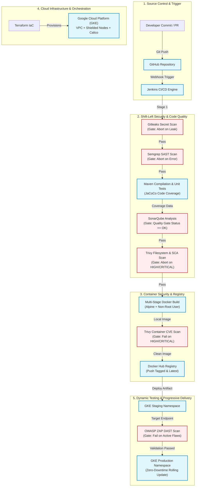

# CloudDeploy — DevSecOps CI/CD Cloud Deployment Platform

[](https://github.com/VITHYAA17/Cloud-Deploy)
[](https://github.com/VITHYAA17/Cloud-Deploy)
[](https://github.com/VITHYAA17/Cloud-Deploy)

> **CloudDeploy** is a production-grade DevSecOps platform and automated CI/CD pipeline for a containerized Java Spring Boot microservice. It enforces shifting security left by integrating static code analysis, dependency vulnerability scanning, secret detection, container image hardening, and dynamic application security testing (DAST) before releasing workloads to Google Kubernetes Engine (GKE).

---

## 📌 Project Highlights & Resume Summary

* **Enhanced CI/CD Workflow**: Built and secured an end-to-end Jenkins pipeline automating application builds, unit testing with code coverage, container image packaging, and zero-downtime Kubernetes deployments.
* **Shift-Left Security & Configurable Quality Gates**: Integrated **SonarQube**, **Semgrep**, **Trivy**, and **Gitleaks** with configurable build-failure thresholds (`HIGH,CRITICAL`) to halt builds and prevent vulnerable artifacts from advancing.
* **Cloud Infrastructure as Code (IaC)**: Provisioned GCP infrastructure (VPC, custom subnets, Calico network policies, and a hardened GKE cluster with shielded node pools) using **Terraform**.
* **Pre-Release Dynamic Security Validation**: Incorporated **OWASP ZAP** into the deployment lifecycle to execute dynamic application security testing (DAST) against a staging environment before authorizing production release.

---

## 🏗️ Architecture & DevSecOps Pipeline Flow



---

## 🛡️ Security Gates & Policy Enforcement Matrix

| Security Tool | Scan Stage | Focus Area | Default Threshold | Action on Breach |
| :--- | :--- | :--- | :--- | :--- |
| **Gitleaks** | Pre-Build | API keys, GCP credentials, private keys, passwords | Any detected secret | Immediate build termination |
| **Semgrep** | Pre-Build | Static Application Security Testing (OWASP Top 10, Java rules) | `ERROR` / High severity rules | Halts pipeline before build |
| **SonarQube** | Post-Test | Code quality, technical debt, bugs, vulnerabilities, test coverage | Sonar Quality Gate (`OK`) | Aborts pipeline execution |
| **Trivy (SCA)** | Pre-Package | Open-source third-party dependencies in `pom.xml` | `HIGH,CRITICAL` (ignore unfixed) | Blocks container packaging |
| **Trivy (Image)**| Post-Build | OS base packages and library CVEs in Docker image | `HIGH,CRITICAL` (exit-code 1) | Prevents registry push |
| **OWASP ZAP** | Post-Deploy | Dynamic Application Security Testing (DAST) on live staging endpoint | High-risk active vulnerabilities | Prevents promotion to production |

---

## 📁 Repository Structure

```text
Cloud Deploy/
├── Jenkinsfile                          # End-to-end DevSecOps declarative pipeline
├── README.md                            # Comprehensive architecture and setup documentation
├── sonar-project.properties             # SonarQube scanner & JaCoCo coverage configuration
├── .gitleaks.toml                       # Gitleaks secret detection rules and allowlists
├── .semgrep.yml                         # Semgrep SAST security rules for Java & Spring Boot
├── app/
│   ├── pom.xml                          # Maven build file with JaCoCo and Sonar plugins
│   ├── Dockerfile                       # Hardened multi-stage build running as non-root user
│   └── src/
│       ├── main/
│       │   ├── java/com/clouddeploy/
│       │   │   └── CloudDeployApplication.java   # Spring Boot REST microservice & health endpoints
│       │   └── resources/
│       │       └── application.properties        # Application runtime properties
│       └── test/
│           └── java/com/clouddeploy/
│               └── CloudDeployApplicationTests.java # Unit & MockMvc tests for JaCoCo coverage
├── kubernetes/
│   ├── deployment.yaml                  # Production K8s deployment with securityContext & probes
│   ├── service.yaml                     # Production LoadBalancer service
│   ├── staging-deployment.yaml          # Staging K8s deployment for DAST testing
│   └── staging-service.yaml             # Staging service endpoint for OWASP ZAP
├── security/
│   ├── trivy/
│   │   └── trivy.yaml                   # Trivy vulnerability scanner configuration
│   ├── zap/
│   │   └── zap-baseline.conf            # OWASP ZAP baseline scan rules configuration
│   └── scripts/
│       ├── gitleaks-scan.sh             # Automated secret detection runner
│       ├── semgrep-scan.sh              # Automated SAST runner
│       ├── trivy-scan.sh                # SCA & container image scanner runner
│       └── owasp-zap-scan.sh            # DAST scanner runner with HTML/JSON report generation
└── terraform/
    ├── main.tf                          # VPC, Subnet, GKE Cluster with Shielded Nodes & Calico
    ├── variables.tf                     # Configurable GCP parameters (project_id, region, nodes)
    └── outputs.tf                       # GKE connection endpoints and cluster outputs
```

---

## 🚀 Setup & Execution Guide

### 1. Local Security Testing (CLI or Docker)

You can run any of the security scans locally prior to pushing code:

* **Secret Detection (Gitleaks):**
  ```bash
  chmod +x security/scripts/*.sh
  ./security/scripts/gitleaks-scan.sh
  ```

* **Static Analysis (Semgrep):**
  ```bash
  ./security/scripts/semgrep-scan.sh
  ```

* **Filesystem & Dependency SCA Scan (Trivy):**
  ```bash
  ./security/scripts/trivy-scan.sh fs app
  ```

* **Container Image Scan (Trivy):**
  ```bash
  docker build -t clouddeploy-app:local app/
  ./security/scripts/trivy-scan.sh image clouddeploy-app:local
  ```

* **Dynamic Security Testing (OWASP ZAP):**
  ```bash
  ./security/scripts/owasp-zap-scan.sh http://localhost:8080
  ```

---

### 2. Infrastructure Provisioning (Terraform)

Provision the hardened Google Kubernetes Engine (GKE) cluster:

```bash
cd terraform
terraform init
terraform plan -var="project_id=YOUR_GCP_PROJECT_ID"
terraform apply -var="project_id=YOUR_GCP_PROJECT_ID" -auto-approve
```

---

### 3. Jenkins CI/CD Setup

1. **Required Jenkins Plugins**:
   * *Pipeline*
   * *SonarQube Scanner*
   * *Docker Pipeline*
   * *Google Kubernetes Engine Plugin*

2. **Configured Credentials**:
   * `dockerhub-credentials-id`: Username with password for Docker Hub registry.
   * `gcp-service-account-key`: Secret file containing GCP Service Account JSON key with GKE Admin rights.
   * `SonarQubeServer`: Configured under *Manage Jenkins > Configure System > SonarQube servers*.

3. **Configurable Pipeline Parameters**:
   * `FAIL_ON_SECRETS` (Default: `true`)
   * `FAIL_ON_SEMGREP` (Default: `true`)
   * `FAIL_ON_SONAR_GATE` (Default: `true`)
   * `TRIVY_SEVERITY_THRESHOLD` (Default: `HIGH,CRITICAL`)
   * `FAIL_ON_ZAP_HIGH` (Default: `true`)

---

## 💬 Interview Quick-Reference & Talking Points

When presenting this project to interviewers:

1. **Why "Shift-Left"?**
   > *"By running Gitleaks and Semgrep before compilation, and Trivy and SonarQube before packaging, we detect credential leaks, syntax-level OWASP flaws, and vulnerable libraries in seconds, rather than days after deployment."*

2. **Why both Static (SAST) and Dynamic (DAST) testing?**
   > *"SAST (Semgrep/SonarQube) inspects the source code for programming anti-patterns and known flaw signatures. DAST (OWASP ZAP) interacts with the running application over HTTP, validating server headers, authentication mechanisms, and runtime injection flaws that static scanners cannot observe."*

3. **How does the multi-stage Docker build help security?**
   > *"Stage 1 uses a heavy Maven image with development tooling to build the JAR. Stage 2 copies only the compiled JAR into a minimal Alpine JRE image and creates a non-root unprivileged user (`appuser`). This significantly reduces image size, lowers CVE exposure, and protects the container against privilege escalation."*

4. **How are secrets managed safely?**
   > *"No secrets or keys exist in the repository—guaranteed by Gitleaks and `.gitignore`. Jenkins injects GCP credentials at runtime via Jenkins Credentials binding, and Kubernetes uses Workload Identity to interact with Google Cloud services without permanent credentials stored in pods."*
